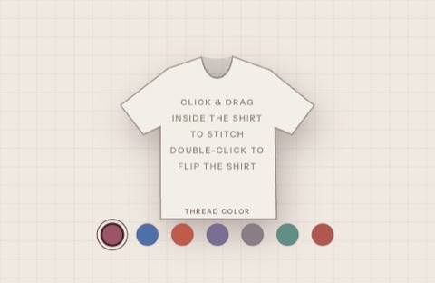

# Thread drawing

Pick a thread color and stitch on a t-shirt. Double-click to flip the shirt between off-white and black.



One canvas, no DOM elements. The shirt is a `Path2D`, so `isPointInPath` decides whether a stroke lands on the garment, and `clip` keeps the thread inside the silhouette: the drawable area is the shape itself, not a rectangle standing in for it. Points are only recorded past a minimum distance, so a slow drag doesn't pile up hundreds of coordinates in one spot. The whole layout, swatches included, is recomputed from the canvas size on resize.

## Run it

No build step. Open `index.html` in a browser, or serve the folder:

```bash
npx serve .
```

## Files

- `index.html`: the page, a full-window canvas
- `thread-drawing.js`: everything else

Made by [Karen Dettmar](https://karendettmar.com). Originally an experiment in her portfolio's Lab.
